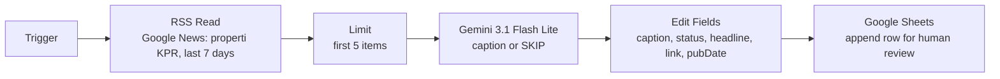

# Property News into Instagram Caption Generator (n8n + Gemini)

## What this does

A n8n workflow that turns recent Indonesian property news into draft Instagram captions every monday, aimed at first-time home buyers aged 22–32. It skips anything that is not related to properties. Outputs are sent to a google sheet for review by a person.

## Architecture

1. **Trigger.** Weekly schedule trigger that runs this workflow every week on monday
2. **RSS Read.** Reads Google News RSS search using this link
   `https://news.google.com/rss/search?q=properti+KPR+when:7d&hl=id&gl=ID&ceid=ID:id`
   This looks for Indonesian KPR and property news from the last 7 days.
3. **Limit.** Keeps the first 5 items to stay within free tier model limits.
4. **Gemini (Message a model).** Model: **Gemini 3.1 Flash Lite**. Receives only the headline and returns one caption. If it sees a non property related article, it outputs the word `SKIP`.
5. **Edit Fields.** Flattens the nested response into `caption`, `status`, `headline`, `link`, `pubDate`. `status` is `SKIPPED` when the model returned `SKIP`, otherwise `READY`. Edit Fields is done so that the models output is human readable and strips away unneeded data.
6. **Google Sheets.** Appends one row per item. A person reads each caption against its headline before posting.

## Key design decisions

- **Headline-only input.** The model sees only the headline, not the article. The cost is plainer captions.
- **SKIP for off-topic items.** News feeds return unrelated stories, so the model has a way to reject them. SKIP rows stay in the sheet labeled `SKIPPED`, which keeps the filter visible and auditable.
- **Human approval, no auto-posting.** Posting through the Instagram Graph API is possible. But it requires a professional Instagram account, a Meta developer app with publishing permission, and a long-lived access token. I did not build it because of time constraints.
- **Gemini 3.1 Flash Lite on a free API key.** The task is short Indonesian copy written from a headline, so a small, fast model is used.
## Prompt iteration

The prompts were iterated while testing. Every version is in `Prompt Versions'.

| Stage           | Change                                                                                                                          | What I saw                                                                                                                                                                                                  |
| --------------- | ------------------------------------------------------------------------------------------------------------------------------- | ----------------------------------------------------------------------------------------------------------------------------------------------------------------------------------------------------------- |
| Test 1 (`01_…`) | Initial prompt, setup voice, headline-only rule, structure, SKIP rule                                                           | Captions called things official or current when the headline did not (for example "kini resmi membedakan" when the headline said only "Bedakan"). Opinion pieces were treated as news.                      |
| Test 2 (`02_…`) | Added a rule against words implying status, timing or officialness                                                              | Captions still contained urgency and facts that were not in the headline.                                                                                                                                   |
| Test 3 (`03_…`) | Added a rule against unsupported features, quotas, trends and urgency                                                           | The model still hallucinated information.                                                                                                                                                                   |
| Test 4 (`04_…`) | Added rules against "link di bio", against dropping the headline's named subject (MBT), and against two filler phrases          | Banned words still appeared ("kini" again), and the model expanded the abbreviation MBT as "Masyarakat Berpenghasilan **Tidak Tetap**". Indonesian news sources define it as "Berpenghasilan **Tanggung**". |
| Final (`05_…`)  | Provided a few-shot prompt: XML tags, positive rules, four examples (one SKIP), sentence counts, one fixed emoji, four hashtags | Earlier failures disappeared. However some banned words are still used                                                                                                                                      |

### Why the final prompt looks the way it does

- Adding rules and ban lists did not stop hallucination, so I used  few shot examples that show the model what a correct caption looks like. This has been the most impactful improvement
- LLM's models cannot count words, so I replaced "70–100 words" with sentence counts.

## Test results

**SKIP tests.**
- Technology feed: I pointed the RSS node at an English technology / science / gaming / AI / cybersecurity query
  (`https://news.google.com/rss/search?q=technology+OR+science+OR+gaming+OR+artificial+intelligence+OR+cybersecurity+when:7d&hl=en-US&gl=US&ceid=US:en`)
  and the model returned SKIP. The property feed  also returns off-topic items and those were SKIPPED too

**Final prompt, 5 property headlines** (full captions and notes in `examples.md`):

- Format rules were met in all 5: one emoji, exactly four hashtags, the `Sumber:` line, correct paragraph structure.
- 2 captions were clean and 3 had small grounding slips:
  - "ketersediaan unit subsidi" and "target pemerintah" (not in the headline),
  - "tengah dibahas" (status not in the headline),
  - "opsi pembiayaan baru … saat ini" (timing words not in the headline).
- All 5 reused the same template: the hook is the headline plus "sudah kamu dengar?", the second paragraph opens the same way, and every closing says "bisa kamu baca di sumber aslinya, ya". The few-shot examples were copied too closely. A real account would need more variety.
- This is one run per prompt version, not a statistical result.

## Known limitations and what I'd do instead

- **Headline-only** Has the AI generate generic "why it matters" lines and some repetition. This is a massive limitation because the AI cannot read the article itself and only the headline. This is beacuse I only used the RSS feed node that can pull in data from any standard feed. But every RSS feed is different, some provide the whole body of the article, others provide only a summary, etc. Because of this I could only rely on the headline. In the future, I would experiment with the Apify API so it can collect news. Then an AI agent can evaluate and classify the content based on the chosen categories. Then a second agent can generate the post
- **Opinion pieces** pass as news. The prompt filters by topic, not by article type (one of the five headlines was an opinion piece). In the future, I would flag opinion pieces aswell
- **Links** are Google News redirect URLs, not original article URLs. This is yet another limitation of RSS
- **Prompt rules are not guarantees.** The model ignored a banned-word rule in an earlier version. Though this is fixed by using few-shot prompts, it is not perfect. This is a limitation of using older models who cannot reason as well as newer models, and requires more specific prompting from the user. In the future, better research on prompting rules may be conducted to ensure as few mistakes as possible
- **Trial limits.** The n8n account is a free trial, so a scheduled run was not demonstrated.
- **No deduplication.** The same story from two outlets would produce two rows. This can be fixed by having the AI classify and dedupe the articles which returns as a JSON, then generate a caption using that data.

## Next steps

1. Fetch article text so captions can use real facts and be less generic.
2. Add deduplication across outlets.
3. Experiment publishing through the Instagram Graph API.
4. Vary the few-shot examples and add a glossary (for example MBT = Masyarakat Berpenghasilan Tanggung) so the model can explain terms without inventing them.
5. Add a filter to prevent deduplication and opinion pieces.

## How to run it

1. Import `workflow.json` into n8n (workflow menu -> Import from File).
2. Create a Gemini credential (Google AI API key) and add the key in the "Message a model" node.
3. Create a Google Sheet with columns `pubDate`, `headline`, `caption`, `status`, `link`, `approved`, and select it in the Google Sheets node.
4. Execute the workflow.

The workflow JSON contains credential names and IDs but not the API key itself.

## AI assistance

I built the n8n workflow myself. I used Claude to review my prompts and outputs, research prompting techniques and debug node configuration. I ran the workflow, checked the outputs against the headlines and made the final decisions. 